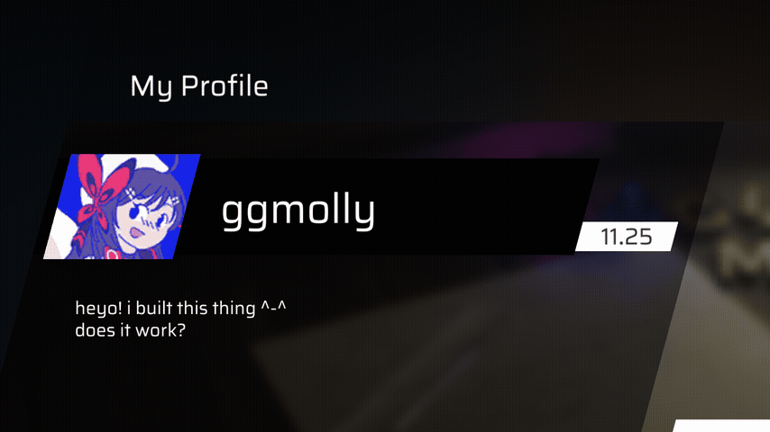

# RKS precision

A mod for [Phigros++](https://github.com/ggmolly/PhigrosPlusPlus) that shows the RKS with three decimals instead of two, so a play that raises it by less than 0.01 still shows. It's in the player's bar, on the Profile page and in the cloud save popup.

## Install

Open the **Mods** tab of the game's settings and pick RKS precision in the catalog, or open [this link](phigrospp://install/ggmolly/phigrospp-rks-precision) on the device.

## How it works

The game keeps the RKS as a full number and only rounds it when writing it on screen. The mod writes it again, rounded to 0.001, right after the game does. Nothing is saved and the RKS itself doesn't change.

On iOS it needs JIT, its hooks aren't written into the IPA.
